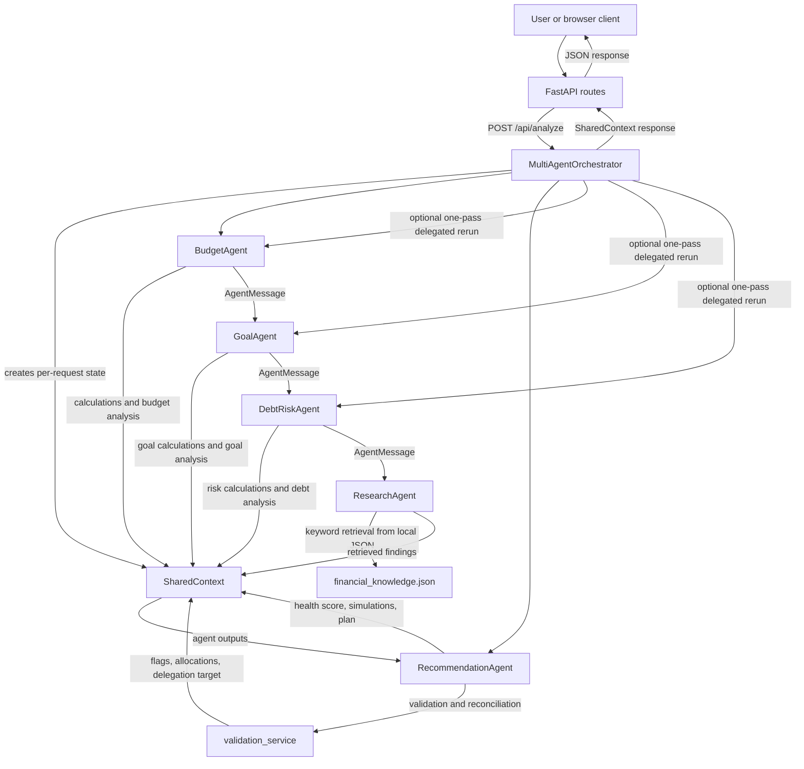
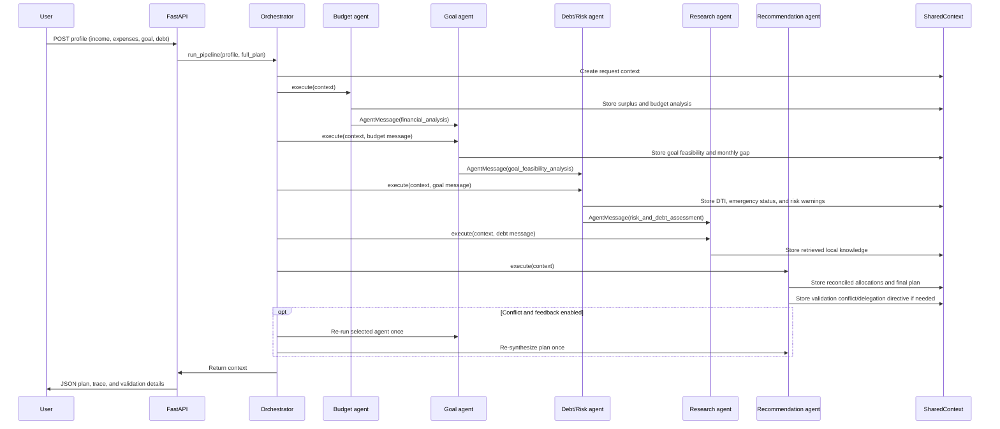

# FinAgent AI — Multi-Agent Personal Finance Assistant

FinAgent AI is an educational personal-finance web application and API. It analyzes a submitted financial profile with specialized budget, goal, debt/risk, research, and recommendation agents. Python calculation functions provide the numeric results; an optional language-model service supplies narrative synthesis and can fall back to a local rule-based response.

The project is a demonstration, not a regulated financial-advice service. Its benchmark score is generated partly from hand-coded scoring rules, so it should not be interpreted as a measure of real-world financial accuracy.

## Contents

- [A. Project overview](#a-project-title-and-overview)
- [B. Problem and requirements](#b-problem-identification--requirement-analysis)
- [C. Architecture and design](#c-multi-agent-architecture--design)
- [D. Agent implementation](#d-agent-implementation)
- [E. Communication and coordination](#e-agent-communication--coordination)
- [F. Tools and knowledge integration](#f-tool--knowledge-integration)
- [G. Functionality and testing](#g-system-functionality--testing)
- [H. Evaluation and comparative analysis](#h-evaluation--comparative-analysis)
- [I. Project structure](#i-project-structure)
- [J. Technology stack](#j-technology-stack)
- [K. Security, privacy, and responsible use](#k-security-privacy-and-responsible-financial-use)
- [L. Limitations and future improvements](#l-limitations-and-future-improvements)
- [M. Conclusion and evaluation mapping](#m-conclusion)
- [N. References](#n-references-and-acknowledgements)

## A. Project Title and Overview

Personal financial planning requires considering income, expenses, savings goals, debt, emergency reserves, and relevant financial guidance together. A single free-form response can make arithmetic errors or fail to explain how competing priorities were reconciled. FinAgent addresses this by separating analysis into focused agents and using deterministic Python functions for calculations and allocation checks.

### Implemented capabilities

- Calculate monthly surplus, savings rate, debt-to-income ratio, loan payoff estimates, and emergency-fund coverage.
- Evaluate goal contributions and deadline feasibility.
- Analyze transaction lists and uploaded CSVs for expense categories, recurring charges, and high-spending outliers.
- Retrieve financial guidelines from a small local JSON knowledge base using keyword-overlap ranking.
- Reconcile monthly allocations and report risk indicators.
- Compare debt avalanche, snowball, and minimum-payment strategies; run what-if scenarios; calculate a rule-based 0–100 health score.
- Provide a FastAPI API and a browser interface served by the same application.
- Use a configured LLM provider for narrative responses when available, or fall back to a local rule-based engine.

### Evaluation components

The sections below explicitly address problem/requirements (B), architecture (C), agent implementation (D), communication (E), tools/knowledge (F), functionality/testing (G), and comparative evaluation (H). Conclusions and evidence are mapped again in section M.

## B. Problem Identification & Requirement Analysis

### Problem statement

The application explores how a personal-finance assistant can combine several related analyses: monthly cash flow, goal affordability, debt repayment burden, emergency savings, and educational financial rules. These analyses use overlapping user data but have different calculations and outputs. The system decomposes them into agents, keeps their intermediate results in a request-scoped context, and assembles a structured plan.

This decomposition is useful for separation of concerns and traceability; it does not establish that multiple agents are inherently more accurate than a single model. The comparison in section H has important scoring limitations.

### Requirements and evidence

| Requirement | Implementation | Verification method | Status |
|---|---|---|---|
| Calculate surplus and savings rate | `BudgetAgent` and financial calculator | Budget and agent tests | Implemented; tested |
| Assess goals and monthly contribution feasibility | `GoalAgent` and goal calculator | Goal, agent, conflict, and API tests | Implemented; tested |
| Assess debt, DTI, emergency reserves, and payoff options | `DebtRiskAgent` and calculation/simulation functions | Debt, simulation, tool, and API tests | Implemented; tested |
| Retrieve educational financial references | JSON knowledge base and keyword-ranked retriever | Knowledge and tool/API tests | Implemented; tested |
| Reconcile allocations and produce a structured plan | Recommendation agent and validation service | Conflict, delegation, end-to-end, and API tests | Implemented; tested |
| Accept a financial profile through HTTP | FastAPI and Pydantic `UserProfile` | FastAPI `TestClient` endpoint tests | Implemented; tested |
| Analyze uploaded transaction CSV | `/api/upload-csv`, Pandas, 5 MB size check | API and advanced-feature tests | Implemented; tested for representative valid/invalid cases |
| Serve the browser UI | FastAPI serves `frontend/index.html` and static assets | App route and frontend source inspection | Implemented; automated browser/E2E coverage not found |
| Use a remote LLM when configured | Provider abstraction in `LLMService` | Provider tests mock HTTP responses | Implemented; provider behavior tested with mocks; live-provider operation is environment-dependent |
| Work without remote LLM credentials | Local completion fallback | Provider/fallback tests; test run with local provider | Implemented; tested |
| Protect API access and user data for deployment | No authentication or access-control layer found; wildcard CORS | Source inspection | Not implemented; this is a local academic/demo application |
| Guarantee financial correctness in practical use | Rule calculations exist, but input assumptions and benchmark coverage are limited | Source and evaluation inspection | Not established |

### Inputs and outputs

The `/api/analyze` endpoint accepts a JSON profile with required `monthly_income`, `fixed_expenses`, and `variable_expenses`; optional `existing_savings`, `emergency_fund`, `risk_tolerance`, `currency`, `goals`, `debts`, and `transactions` are defined in [`backend/models/user_profile.py`](backend/models/user_profile.py). Goal and debt records have their own Pydantic schemas. CSV uploads are analyzed separately through `/api/upload-csv`; that endpoint returns the raw rows and analysis but does not automatically attach them to a later profile request.

The application returns a structured financial plan and supporting budget, goal, debt/risk, research, validation, health-score, alert, message, and tool-call data. Other routes return simulation results, debt comparisons, chat responses, knowledge matches, exchange-rate data, and downloadable text reports.

### Intended users, scope, and limitations

The intended users are students, evaluators, and individuals exploring educational budgeting scenarios. The system is not an account aggregator: it does not connect to bank accounts, verify user-submitted data, perform actual transactions, or persist financial profiles in a backend database. Its default currency symbol is ₹, but the calculations do not perform currency conversion. The exchange-rate route is a separate data endpoint.

Budget, goal, debt, and score rules are simplified. The results depend on the profile supplied and the assumptions encoded in the calculation functions; they should be checked independently before being used for real financial decisions.

## C. Multi-Agent Architecture & Design

### Request and data flow

The normal API and benchmark call the pipeline sequentially (`parallel_mode=False`). The orchestrator also contains an optional thread-pool branch for goal, debt, and research work, but that branch is not used by the main analysis endpoint.



The recommendation agent reads the results stored in `SharedContext`; it is not passed the research message as an explicit function argument. In the normal pipeline, the orchestrator executes budget, goal, debt/risk, and research work in order, then invokes recommendation. Calls to the LLM service occur within agents to produce narrative summaries; the numerical calculations and validation rules are Python code.

### Agent responsibility and interaction summary

| Agent | Main input | Work and tools | Output and interaction |
|---|---|---|---|
| Budget | Profile income, fixed/variable costs, optional transactions | Surplus and savings-rate calculations; optional transaction analysis; LLM-generated summary | Writes `budget_analysis` and optional `transaction_analysis`; emits a `financial_analysis` message |
| Goal | Profile goals and budget surplus (usually from budget message) | Calculates required contributions, priority order, feasibility, and gaps; LLM-generated summary | Writes `goal_analysis`; emits `goal_feasibility_analysis` |
| Debt/Risk | Profile income, fixed costs, emergency fund, debts; normally goal message | Calculates EMI payoff estimates, DTI, emergency coverage, and risk flags; LLM-generated summary | Writes `debt_risk_analysis`; emits `risk_and_debt_assessment` |
| Research | Current budget, goal, and debt results in shared context | Builds a query and ranks local JSON records by keyword overlap; LLM-generated summary | Writes `research_results`; emits `knowledge_and_citations` |
| Recommendation | All analyses in shared context | Reconciles allocations; calculates score, subscription analysis, debt-strategy comparison, and a default scenario; synthesizes final plan | Writes validation, plan, alerts, and related outputs; emits final recommendation message |
| Orchestrator | Profile and task-intent string | Selects agents, creates context, coordinates execution, records delegation, and handles pipeline-level exceptions | Returns the populated `SharedContext` to the API |

Agent implementations are in [`backend/agents/`](backend/agents/). The runtime uses an LLM for narrative synthesis where configured, but the calculations, goal-feasibility decisions, retrieval ranking, and allocation rules are deterministic code. No machine-learning model trains on user data.

### Selection, execution, and failure behavior

`select_agents()` selects budget + goal + recommendation for goal intents; budget + debt/risk + research + recommendation for debt/risk intents; otherwise all five agents. The API accepts `task_intent` as a query parameter and defaults it to `full_plan`.

The orchestrator creates a fresh `SharedContext` for each pipeline run. Agent exceptions are not individually normalized by `BaseAgent`; a pipeline-level exception handler logs the error to standard output and attempts recommendation-agent recovery. The HTTP route also converts uncaught exceptions into HTTP 500 responses. This recovery behavior is best-effort, not a guarantee that a valid plan can always be returned.

The orchestrator has a maximum-step constant and one feedback/delegation pass after validation. Its optional parallel branch has a nominal timeout, but the executor context waits for submitted work when exiting; it should not be considered a hard cancellation guarantee. The main API uses the sequential branch.

## D. Agent Implementation

All five agent classes extend [`BaseAgent`](backend/agents/base_agent.py), which provides a common execution signature, message construction, task-state recording, and tracked tool invocation. Each specialist calls `LLMService.generate_completion()` for a narrative; no agent delegates numerical arithmetic to the model.

### Budget agent

[`budget_agent.py`](backend/agents/budget_agent.py) reads income, fixed and variable costs, and optional transactions from shared user data. It calls `calculate_monthly_surplus`, `calculate_savings_rate`, and, when transactions exist, `analyze_transaction_list`. It derives housing and variable-cost ratios and simple observations, asks the LLM service for a short narrative, stores the result in `budget_analysis`, and sends a structured message to the goal agent. The deterministic tool outputs are kept alongside the generated narrative.

### Goal agent

[`goal_agent.py`](backend/agents/goal_agent.py) reads the profile goals and available surplus from its input message or shared budget analysis. `evaluate_financial_goals` sorts goals by priority and deadline, computes the required monthly amount, allocates available surplus, and reports feasibility and gaps. The agent stores the results and sends a `goal_feasibility_analysis` message to the debt/risk agent.

### Debt and risk agent

[`debt_risk_agent.py`](backend/agents/debt_risk_agent.py) iterates over debts, calculates payoff estimates, totals monthly EMIs, computes DTI and emergency-fund coverage, and applies code-defined thresholds for risk warnings. It stores `debt_risk_analysis` and sends the results to the research agent. LLM output is a risk narrative, not the source of the numeric risk calculations.

### Research agent

[`research_agent.py`](backend/agents/research_agent.py) constructs a keyword query from the budget, goal, and debt results, then calls `KnowledgeRetriever.query()` against [`financial_knowledge.json`](backend/data/financial_knowledge.json). It classifies user-provided facts, calculated metrics, and retrieved records separately, stores the results, and sends a message to the recommendation agent. Retrieval uses keyword overlap, not vector embeddings.

### Recommendation agent

[`recommendation_agent.py`](backend/agents/recommendation_agent.py) calls `validate_and_reconcile_plan()` to check expense deficits, prioritize emergency-fund and high-interest-debt allocations, cap goal allocations to remaining surplus, and return validation flags. It then calculates a rule-based health score, analyzes subscriptions, compares debt payoff methods, runs a built-in extra-savings scenario, assembles alerts and action items, and creates a typed `FinancialPlanOutput`. Its executive summary is generated through `LLMService`.

The code creates an agent-contribution list in the final plan. That list is a fixed-format summary assembled by the recommendation agent; it is not a separately collected independent audit from each agent.

### Orchestrator

[`orchestrator.py`](backend/agents/orchestrator.py) instantiates the five agents, selects a subset from task intent, executes the dependency sequence, then invokes recommendation. If validation reports a conflict and feedback is enabled, it records a delegation entry, reruns the targeted budget, goal, or debt/risk agent, and reruns recommendation once. The implementation does not continue in an unbounded validation loop.

The single-agent baseline is a separate monolithic prompt path. It does not execute the specialist agents or their tools; see the evaluation caveats in section H.

## E. Agent Communication & Coordination

### Message and shared-state model

[`AgentMessage`](backend/models/agent_messages.py) is a Pydantic model with `id`, `task_id`, `sender`, `receiver`, `message_type`, structured `data`, `confidence`, `status`, `timestamp`, `step_id`, and a human-readable `summary`. Its `payload` property returns `data`. `SharedContext` is a mutable Pydantic model that holds the profile, each agent’s analysis, validation, plan, task states, messages, tool calls, and delegation/conflict histories.

Agents communicate using both the explicit messages (appended to `SharedContext.messages`) and shared state fields. The orchestrator passes a predecessor message to some agents, but not all agents derive their inputs from that argument: for example, the research agent reads current analyses from shared context.

### Illustrative coordination example

The following sequence illustrates a profile with monthly income, expenses, a savings goal, and debt. It is not a captured runtime trace.



The example sequence describes the default sequential pipeline. If validation requests a targeted rerun, the orchestrator records the target and reason in `delegation_history`. In the provided benchmark, a “coordination loop” is counted as a delegation-history entry, not as every agent call or every LLM/tool invocation. Pipeline-level exceptions are recorded/logged by the orchestrator, but there is no durable message queue or distributed agent runtime.

## F. Tool / Knowledge Integration

### Registered chat/action tools

[`ToolRegistry.get_tool_definitions()`](backend/tools/tool_registry.py) currently defines **seven** structured actions; the source does not confirm the sometimes-mentioned total of eight. The registry returns JSON-schema-like definitions, and `execute_tool()` returns JSON results or UI actions. The chat assistant directly dispatches navigation, goal creation, and savings simulation in its current code paths; the other registry definitions remain callable through the registry but do not have a direct `execute_tool()` call site in `ChatAssistant`.

| Registered action | Inputs | Result and implementation |
|---|---|---|
| `navigate_to_page` | `target_page` | Maps a page name to a frontend view ID and returns a navigation action |
| `get_financial_overview` | `monthly_income`, `fixed_expenses`, `variable_expenses` | Intended to return a 50/30/20 comparison and health score; currently passes unsupported keyword arguments to the health-score function and raises `TypeError` |
| `create_financial_goal` | `name`, `target_amount`, `deadline_months`, optional `priority` | Returns a create-goal action; profile mutation is left to the frontend |
| `update_budget` | `monthly_income`, `fixed_expenses`, `variable_expenses` | Returns an update-budget action; marked as requiring confirmation |
| `analyze_debt` | `debts[]`, optional `extra_monthly_allocation` | Returns debt strategy comparison results |
| `run_savings_simulation` | optional `income_delta`, `expense_reduction`, `extra_savings` | Returns a what-if result and run-simulation action |
| `search_financial_knowledge` | `query` | Returns up to three locally retrieved knowledge records |

An unsupported registry name returns `success: false`. Numeric conversion and other tool errors are not covered by a uniform tool-level error schema.

### Internal analysis and calculation tools

These are ordinary Python functions used by agents or API routes, not additional LLM function-calling definitions.

| Module | Purpose and use |
|---|---|
| [`financial_calculator.py`](backend/tools/financial_calculator.py) | Surplus, savings rate, DTI, emergency-fund coverage, payoff estimate, 50/30/20 comparison, and simple high-expense flagging |
| [`goal_calculator.py`](backend/tools/goal_calculator.py) | Required goal contributions, prioritization, feasibility, and allocation gaps |
| [`transaction_analyzer.py`](backend/tools/transaction_analyzer.py) | Pandas-based aggregation of income/expenses and categories; heuristic recurring-charge and outlier detection |
| [`health_score_calculator.py`](backend/tools/health_score_calculator.py) | Rule-based five-part score, each category worth up to 20 points |
| [`simulation_engine.py`](backend/tools/simulation_engine.py) | What-if cash-flow simulation and debt avalanche/snowball/minimum-payment comparison |
| [`subscription_optimizer.py`](backend/tools/subscription_optimizer.py) | Keyword-based recurring-charge scan and estimated annual cost |
| [`knowledge_retriever.py`](backend/tools/knowledge_retriever.py) | Local JSON keyword-overlap retrieval; no embedding model or vector database |
| [`report_generator.py`](backend/tools/report_generator.py) | Generates a plain-text/Markdown-style report from the final plan |
| [`external_financial_data.py`](backend/tools/external_financial_data.py) | Requests exchange rates from `open.er-api.com`; returns hard-coded fallback rates on failure. Market benchmark values are static in this implementation. |

Agent tool invocations are timed and appended to `SharedContext.tool_calls` by `BaseAgent.execute_tool()`. The evaluation counters count these instrumented invocations; they do not represent all Python helper calls or external HTTP requests. LLM calls are calls to `generate_completion()`, not necessarily individual provider HTTP attempts (the service may retry).

### LLM and external data configuration

`LLMService` contains provider paths for Groq, Gemini, OpenAI-compatible chat completions, Ollama, and a local rule-based fallback. Provider HTTP responses are handled by the service, with configured timeouts/retries and a local fallback in several failure cases. Gemini is called through its REST endpoint in the implementation. The dependency on `google-genai` is listed in `requirements.txt`, but the LLM service code uses HTTP requests rather than importing that SDK.

The example configuration is in [`.env.example`](.env.example). Relevant keys include `LLM_PROVIDER`, `GROQ_API_KEY`, `GEMINI_API_KEY`, `OPENAI_API_KEY`, `LLM_MODEL`, `LLM_TIMEOUT`, `LLM_RETRY_LIMIT`, `LLM_MAX_TOKENS`, `OLLAMA_BASE_URL`, and `OLLAMA_MODEL`. For an OpenAI-compatible endpoint, configure the corresponding base URL as well. Keep real keys in the ignored `.env` file; do not paste them into source code or reports.

The optional `FINANCIAL_API_KEY` variable appears in the example environment file but is not used by the current exchange-rate implementation.

## G. System Functionality & Testing

### Prerequisites and installation

- Python 3.10 or later is the project’s documented baseline.
- Windows PowerShell commands are shown below; a Python environment with `pip` is required.
- A remote LLM key is optional. The local fallback supports offline analysis.

From the repository root:

```powershell
python -m venv .venv
.\.venv\Scripts\Activate.ps1
python -m pip install --upgrade pip
python -m pip install -r requirements.txt
if (-not (Test-Path .env)) { Copy-Item .env.example .env }
```

For an offline run, set `LLM_PROVIDER=local` in `.env`. For a hosted model, configure the provider and its key/model in `.env`; never commit that file.

### Start the application

```powershell
python run.py
```

Alternatively, on Windows:

```powershell
.\start.ps1
```

The launcher starts `backend.main:app` with Uvicorn, bound to `127.0.0.1:8000`, with reload watching the `backend` and `frontend` directories. Open:

- Web UI: <http://127.0.0.1:8000/>
- FastAPI interactive API docs: <http://127.0.0.1:8000/docs>
- Health endpoint: <http://127.0.0.1:8000/api/health>

The frontend is plain HTML, CSS, and JavaScript served by FastAPI; there is no separate frontend package manager or build step in the repository.

### Example analysis request

`POST /api/analyze` accepts the Pydantic `UserProfile`; `task_intent` is an optional query parameter.

```powershell
$profile = @{
    monthly_income = 60000
    fixed_expenses = 20000
    variable_expenses = 10000
    emergency_fund = 30000
    goals = @(
        @{ name = "Laptop"; target_amount = 60000; deadline_months = 6; priority = 1 }
    )
    debts = @(
        @{ name = "Personal Loan"; total_balance = 50000; monthly_emi = 3000; interest_rate_annual = 10.5 }
    )
}
$body = $profile | ConvertTo-Json -Depth 10
Invoke-RestMethod -Method Post `
    -Uri "http://127.0.0.1:8000/api/analyze?task_intent=full_plan" `
    -ContentType "application/json" `
    -Body $body
```

The response includes `status`, `execution_time_seconds`, `final_plan`, `agent_messages`, `agent_states`, each agent analysis, `validation_results`, `health_score`, `delegation_history`, and `tool_calls`. A shortened shape is:

```json
{
  "status": "success",
  "execution_time_seconds": 0.0,
  "final_plan": {
    "summary": {},
    "budget_breakdown": {},
    "goal_evaluations": [],
    "debt_evaluation": {},
    "risk_assessment": [],
    "proposed_monthly_plan": [],
    "action_plan": [],
    "agent_contributions": [],
    "citations_and_sources": []
  },
  "agent_messages": [],
  "validation_results": {}
}
```

The `0.0` above is a schema illustration, not a promised or measured response time.

### API routes

| Method and route | Purpose |
|---|---|
| `GET /api/health` | Service, agent, knowledge-base, and LLM connectivity status |
| `GET /api/settings/connectivity-test` | Test configured LLM connectivity |
| `GET /api/external-data/rates?base=INR` | Exchange-rate endpoint and static market benchmark data |
| `POST /api/analyze` | Multi-agent profile analysis |
| `POST /api/baseline` | Single-agent baseline response |
| `POST /api/simulate` | What-if profile simulation |
| `POST /api/debt-strategies` | Compare debt payoff strategies |
| `POST /api/generate-report` | Return a text report |
| `POST /api/chat` and `POST /api/chat/clear` | Conversational assistant and in-memory history reset |
| `POST /api/evaluate` | Run the comparative evaluation script |
| `POST /api/upload-csv` | Upload and analyze a CSV (maximum 5 MB) |
| `GET /api/knowledge?q=...` | Search the local financial knowledge file |

### Tests and observed results

Run the automated suite from the root:

```powershell
python -m pytest -q
```

The suite was run for this README update with the LLM provider forced to `local` and `.env` loading disabled for the test process to avoid using configured credentials. **Result: 58 passed, 0 failed, 0 skipped; one Starlette deprecation warning** about using `httpx` with `starlette.testclient` (the warning recommends `httpx2`). The external-rate test may contact the public exchange-rate endpoint; if it is unavailable, the tool returns its fallback data.

| Test area | Evidence in tests | Result in full run |
|---|---|---|
| Agent calculations and messages | `test_agents.py`, `test_budget.py`, `test_goals.py`, `test_debt.py` | Passed |
| Orchestration, delegation, and recovery | `test_delegation_and_feedback.py`, `test_failure_recovery.py` | Passed |
| Validation and conflicts | `test_conflict_resolution.py` | Passed |
| Calculation, simulation, and tool behavior | `test_tools_comprehensive.py`, `test_health_score.py`, `test_simulations.py`, plus budget/debt tests | Passed |
| API endpoints and request validation | `test_api_endpoints.py`, `test_health_endpoint.py` | Passed |
| End-to-end pipeline | `test_end_to_end.py` | Passed |
| Provider handling and prompt sanitization | `test_groq_provider.py`, `test_advanced_features_and_security.py` | Passed; provider HTTP cases are mocked |

These are unit and API-level tests. No automated browser-based end-to-end suite was found. Passing tests establish only the tested behavior and do not validate financial advice in real-world cases.

### Feature verification matrix

| Feature | Expected behavior | Verification method | Observed result |
|---|---|---|---|
| Multi-agent analysis | Return a plan with agent outputs and validation | API and end-to-end tests | Passed in test run |
| Budget/goal/debt calculations | Compute values from supplied profile | Unit and agent tests | Passed in test run |
| Conflict delegation | Record a delegation and re-synthesize once | Delegation and conflict tests | Passed in test run |
| CSV analysis | Analyze supported CSV and reject invalid extension/oversized content | API and advanced-feature tests | Passed representative cases |
| LLM fallback | Produce a response without remote inference | Provider tests and local-mode run | Passed |
| Knowledge retrieval | Return matching local knowledge records | Tool/API tests | Passed |
| Live LLM-provider operation | Connect to configured third-party provider | Mocked provider tests only | Not verified against a live provider |
| Browser UX | Render and interact with all screens | Source inspection; no browser test suite found | Not verified end-to-end |

### Troubleshooting

- **Missing LLM key:** set `LLM_PROVIDER=local` for offline use, or add the correct provider key to `.env`. The LLM service may use its local fallback when the configured provider is unavailable.
- **Import errors:** run `python run.py` from the project root so `backend` imports resolve, and install dependencies from `requirements.txt`.
- **Port already in use:** stop the other process using port 8000 before starting the launcher; `run.py` currently hard-codes this port and host.
- **CSV rejected:** the upload route requires a filename ending in `.csv` and rejects files larger than 5 MB.
- **Provider test results differ:** live LLM responses depend on provider availability, model access, network conditions, and credentials; unit tests mock provider HTTP calls.

## H. Evaluation & Comparative Analysis

### Dataset and measurement implementation

[`evaluation/dataset.json`](evaluation/dataset.json) contains eight profile/ground-truth cases. The script [`evaluation/multi_agent_evaluation.py`](evaluation/multi_agent_evaluation.py) compares a monolithic baseline, the full pipeline, and a feedback-disabled pipeline. It uses `time.perf_counter()` around individual system runs, counts calls using `LLMService` class counters, and counts full-pipeline delegations using `len(context.delegation_history)`. It pauses 0.3 seconds between cases, outside the per-run latency measurements.

The script’s reported `average_accuracy_pct` is **not a direct score of generated response correctness**:

- The single-agent baseline does not parse or grade its generated completion. It assigns fixed values for DTI, goal, and risk scores and uses a conditional surplus score.
- The full multi-agent score compares surplus and DTI with ground truth using a tolerance, but goal and risk components are proxy checks. It averages four component scores with equal weight.
- The ablation score is `0.85` when validation reports a conflict and `1.0` otherwise. It does not compare its results against all ground-truth fields.
- The ablation calls `run_pipeline(..., enable_feedback=False)`, but the recommendation agent still calls `validate_and_reconcile_plan()`. Therefore, “without validation” is a misleading label: this path disables feedback/delegation, not validation itself.

The dataset and script provide a runnable experiment, but the scoring design is insufficient to establish that recommendations are financially accurate or that multi-agent reasoning is superior.

### One local-mode run

The benchmark was executed during this README update with `LLM_PROVIDER=local`. The scores and call averages matched the checked-in summary; the latency numbers did not. Latencies below are one environment-specific observation, not stable performance targets.

| Metric | Single-agent baseline | Multi-agent, feedback enabled | “Without validation” ablation* |
|---|---:|---:|---:|
| Reported script score | 84.53% | 99.06% | 94.38% |
| Average per-run elapsed time in this local-mode run | 0.0005 s | 0.0053 s | 0.0038 s |
| Average `generate_completion()` calls | 1.0 | 5.8 | 5.0 |
| Average instrumented agent tool calls | 0.0 | 14.0 | 11.6 |
| Delegation-history entries across eight cases | 0 | 3 | 0 |
| Validation service called | No | Yes | **Yes** |

`*` The ablation disables feedback, not validation; see above.

The reported score differences are +14.53 percentage points for multi-agent versus baseline (about +17.19% relative to the baseline score), and +4.68 percentage points for multi-agent versus the feedback-disabled run (about +4.96% relative to that score). These are differences in the script’s heuristic score only—not measured gains in real-world accuracy.

The saved [`evaluation_summary.json`](evaluation/results/evaluation_summary.json) records the same scores and call averages, but its latency averages (0.6041 s, 0.306 s, and 0.0035 s) differ substantially from the run above. The timing values are not reproduced consistently. No repeated trials, confidence intervals, statistical significance analysis, independent financial review, or controlled live-model comparison is provided. LLM-call counts are completion-method calls; they are not necessarily provider HTTP request counts when retries occur.

### Reproduce the evaluation

From the repository root in PowerShell:

```powershell
$env:LLM_PROVIDER = "local"
python -m evaluation.run_comparison
Remove-Item Env:\LLM_PROVIDER
```

This script writes updated files to `evaluation/results/evaluation_summary.json` and `evaluation/results/evaluation_report.md`. For a sounder evaluation, use independently verified expected outputs, grade each criterion against those outputs, make the ablation actually skip validation, run repeated trials under the same provider/runtime conditions, and report distributions rather than a single timing average.

## I. Project Structure

```text
.
├── backend/
│   ├── agents/                  # Five agents, BaseAgent, and orchestrator
│   ├── data/                    # Local financial knowledge and sample transactions
│   ├── models/                  # User profile, agent messages/context, plan schemas
│   ├── services/                # LLM/chat services and validation/reconciliation
│   ├── tools/                   # Calculation, retrieval, simulation, reporting, registry
│   ├── config.py                # Environment-backed application settings
│   └── main.py                  # FastAPI routes and static frontend serving
├── docs/                        # Architecture, methodology, evaluation, presentation material
├── evaluation/
│   ├── dataset.json             # Eight evaluation scenarios and expected fields
│   ├── single_agent_baseline.py # Monolithic baseline
│   ├── multi_agent_evaluation.py
│   ├── run_comparison.py
│   └── results/                 # Saved evaluation summary and report
├── frontend/
│   ├── index.html
│   ├── app.js
│   └── style.css
├── scripts/                     # Provider connectivity helper
├── tests/                       # Unit, API, provider, coordination, and E2E pipeline tests
├── .env.example                 # Configuration template; no real credentials
├── requirements.txt
├── run.py                       # Uvicorn launcher
└── start.ps1                    # Windows launcher
```

The source-code flow is described in sections C–F. The `docs/` folder includes additional project reports; some contain earlier architectural or evaluation descriptions that do not agree with the current eight-case benchmark code. For implementation and current results, use the source files and evaluation script cited above.

## J. Technology Stack

| Technology | Role |
|---|---|
| Python | Backend, agents, tools, evaluation scripts, and tests |
| FastAPI | HTTP API, request validation integration, OpenAPI docs, and static file serving |
| Uvicorn | ASGI server launched by `run.py` |
| Pydantic v2 | User-profile, agent-message, context, and final-plan models |
| Pandas | Transaction CSV/list analysis |
| Requests | External HTTP calls to LLM providers and the exchange-rate API |
| python-dotenv | Load local environment configuration |
| HTML, CSS, JavaScript | Browser interface; no frontend framework/build tooling detected |
| pytest and pytest-asyncio | Automated tests |
| JSON | Local financial-knowledge data, benchmark dataset, and saved evaluation output |

The knowledge retriever is a simple local lexical ranker; no vector store, embedding service, or database is present. Although `numpy`, `matplotlib`, `seaborn`, and `google-genai` appear in the dependency manifest, they are not required by the main application flow inspected for this README; the Gemini provider implementation uses REST requests.

## K. Security, Privacy, and Responsible Financial Use

- `.env` is listed in [`.gitignore`](.gitignore); `.env.example` contains names/defaults, not keys. Keep credentials out of commits, screenshots, logs, and shared benchmark results.
- If a hosted LLM provider is enabled, prompts containing financial profile details may be sent to that provider. The project does not establish provider-side retention or privacy guarantees. Use local mode or anonymized test data when that is required.
- No authentication, authorization, rate limiting, or database access control was found. The API enables CORS for all origins and `run.py` binds to loopback by default; do not expose this demo to an untrusted network without adding appropriate controls.
- User profile analysis is request-scoped in the backend. Chat history is stored in a process-global in-memory dictionary; it is not durable storage. The frontend persists the selected theme in browser `localStorage`; source inspection found no corresponding financial-profile persistence.
- The CSV endpoint restricts the filename extension and rejects uploads over 5 MB. This is not a complete file-security policy.
- `sanitize_prompt()` replaces several known prompt-injection patterns. Pattern filtering is not a guarantee against prompt injection or malicious content.
- Route handlers can include exception text in HTTP 500 responses, and some helper functions print errors to standard output. These behaviors are not production-grade observability or error redaction.
- The output includes an educational-use disclaimer. Generated narratives and rule-based scores are not regulated advice, individualized investment recommendations, or a substitute for a qualified professional.

## L. Limitations and Future Improvements

### Current limitations evidenced by the implementation

- The comparative evaluation’s accuracy formulas use proxies and do not consistently grade generated outputs against ground truth.
- The purported no-validation ablation still runs validation; only feedback is disabled.
- Latency values vary substantially between the checked-in summary and a fresh local-mode run.
- The knowledge retriever is keyword-overlap based and has no source freshness or citation validation.
- The health score and allocation policy are fixed heuristics. They should not be treated as validated financial standards.
- The `get_financial_overview` registry action currently calls the health-score function with an incompatible argument list; no test covering this registry action was found.
- The backend has no authentication, durable user-data store, or automated browser-based E2E suite.
- Remote LLM behavior and third-party exchange-rate availability depend on external configuration and network conditions.

### Potential future work

- Replace proxy scoring with independently reviewed ground-truth calculations and output-level grading.
- Implement a true validation-off ablation, repeat experiments, control provider/model/runtime, and report per-case distributions and confidence intervals.
- Add test cases for edge conditions, malformed inputs, allocation invariants, provider failure, and currency assumptions.
- Add structured logging, redacted errors, observability, and explicit timeouts/cancellation semantics.
- Add authentication, restrictive CORS, privacy review, and clear retention controls before any deployment beyond local evaluation.
- Validate the knowledge sources, cite source dates, and evaluate retrieval quality.
- Review calculation assumptions with qualified financial subject-matter experts.

## M. Conclusion

FinAgent demonstrates a request-scoped, sequential multi-agent workflow that combines specialist budget, goal, debt/risk, and research analyses with a recommendation agent. Structured messages and shared context make the execution trace inspectable; deterministic Python calculations are separated from LLM-generated narrative. FastAPI exposes the analysis, supporting utilities, evaluation, and browser interface.

| Evaluation component | Evidence in this repository |
|---|---|
| 1. Problem identification and requirements | Section B; `UserProfile`, API routes, and feature/requirement matrices |
| 2. Multi-agent architecture and design | Section C; `orchestrator.py`, `agent_messages.py`, and Mermaid architecture |
| 3. Agent implementation | Section D; individual implementations in `backend/agents/` |
| 4. Agent communication and coordination | Section E; `AgentMessage`, `SharedContext`, delegation tests, and sequence diagram |
| 5. Tool and knowledge integration | Section F; registry, calculation modules, JSON retrieval, LLM service, and exchange-rate route |
| 6. Functionality and testing | Section G; setup/API instructions and the observed 58-pass test run |
| 7. Evaluation and comparison | Section H; eight-case dataset, runnable script, saved result, fresh local-mode run, and explicit scoring caveats |

The project is suitable as an academic prototype and a basis for further evaluation. Its successful tests and benchmark score do not establish production readiness or real-world financial accuracy.

## N. References and Acknowledgements

Official documentation for technologies used or exposed by the project:

- [Python documentation](https://docs.python.org/3/)
- [FastAPI documentation](https://fastapi.tiangolo.com/)
- [Uvicorn documentation](https://www.uvicorn.org/)
- [Pydantic documentation](https://docs.pydantic.dev/latest/)
- [Pandas documentation](https://pandas.pydata.org/docs/)
- [Requests documentation](https://requests.readthedocs.io/en/latest/)
- [pytest documentation](https://docs.pytest.org/en/stable/)
- [Groq API documentation](https://console.groq.com/docs)
- [Gemini API documentation](https://ai.google.dev/gemini-api/docs)
- [OpenAI API documentation](https://platform.openai.com/docs/api-reference)
- [Ollama documentation](https://docs.ollama.com/)
- [ExchangeRate-API open endpoint](https://open.er-api.com/)

This README documents behavior observed in the repository. The benchmark interpretation is intentionally conservative and does not claim independent validation of financial recommendations.
